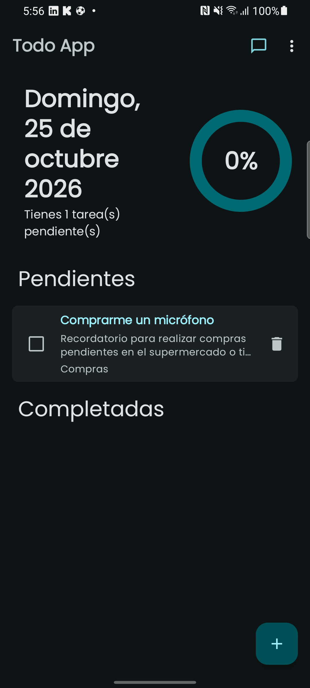
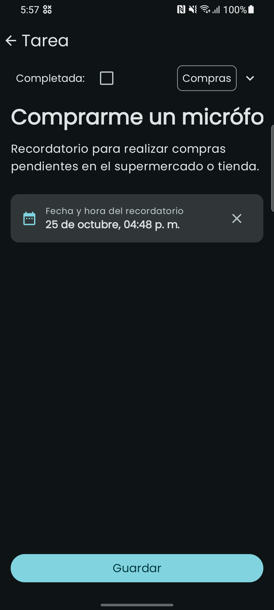

# 📝 Todo App Jetpack Compose 

Una moderna y completa aplicación Android para la gestión de tareas y recordatorios construida con **Jetpack Compose (Material 3)**, **Clean Architecture**,  **Asistente (On-Device)**

---

## 📸 Capturas de Pantalla

| 🏠 Pantalla Principal | ✍️ Detalle de Tarea |
|:---:|:---:|
|  |  |
| Lista de tareas y progreso circular | Fecha, hora, descripción y selector de categoría |

---

## ✨ Características Principales


### 1. ⏰ Notificaciones y Alarmas Confiables en Segundo Plano
* **Funciona con Pantalla Apagada y App Cerrada:** Programado con `AlarmManager.RTC_WAKEUP` y `setExactAndAllowWhileIdle`, despertando el procesador en el minuto exacto incluso bajo modo reposo (*Doze Mode*).
* **Canal de Alta Prioridad:** Sonido predeterminado del sistema, patrón de vibración `[0, 500, 250, 500]` y visibilidad pública en pantalla de bloqueo.
* **Disparo Inmediato:** Si agendas un recordatorio para el minuto actual o recién transcurrido (pruebas de alarmas inmediatas), la notificación suena al instante sin descartarse.
* **Navegación Directa al Detalle:** Al pulsar la notificación emergente o del panel, la app abre directamente la pantalla de detalle de la nota correspondiente (`TaskDetailScreen`), permitiendo regresar a la pantalla principal con el botón Atrás.
* **Persistencia tras Reinicio (`BootReceiver`):** Si el teléfono se apaga o reinicia, las alarmas pendientes se restauran automáticamente desde la base de datos Room.

---

## 🏛️ Arquitectura del Proyecto (Clean Architecture)

El proyecto sigue rigurosamente los principios de **Clean Architecture**, dividiendo la lógica en capas desacopladas y testeables:

*   **Capa de Presentación (Presentation):** Responsable de la UI (`theme`, `components`, `screens`), la navegación y la lógica de presentación (ViewModels).
*   **Capa de Dominio (Domain):** Contiene las entidades, casos de uso y contratos/interfaces de repositorios y servicios.
*   **Capa de Infraestructura (Infrastructure):** Gestiona la persistencia con Room Database, el motor de IA local y la implementación de repositorios.
*   **Capa Core (Core):** Contiene utilidades transversales (`DateTimeUtils`, `UiText`) e inyección de dependencias global (`AppModule` con CoroutineDispatchers).


## 🛠️ Tecnologías y Librerías

* **Lenguaje:** Kotlin 2.0.0
* **Interfaz de Usuario:** Jetpack Compose con Material Design 3
* **Inyección de Dependencias:** Dagger Hilt
* **Persistencia Local:** Room 
* **Notificaciones:** `BroadcastReceiver`, `NotificationCompat` y `NotificationChannel`
* **Testing:** JUnit 4, Kotlinx Coroutines Test, Turbine, MockK

---

## 🧪 Pruebas Unitarias

El proyecto cuenta con una completa suite de pruebas unitarias automatizadas que cubren la lógica de negocio, limpieza de texto, detección conversacional y programación de tareas:

```bash
# En Windows (PowerShell)
.\gradlew testDebugUnitTest

# En Linux / macOS
./gradlew testDebugUnitTest
```


## 🚀 Compilación e Instalación

### Compilar APK Debug
```bash
.\gradlew assembleDebug
```
El archivo APK se genera en:
`app/build/outputs/apk/debug/app-debug.apk`

### Instalar y Ejecutar vía ADB
```bash
adb install -r app/build/outputs/apk/debug/app-debug.apk
adb shell am start -n com.albin.todoapp/.MainActivity
```
